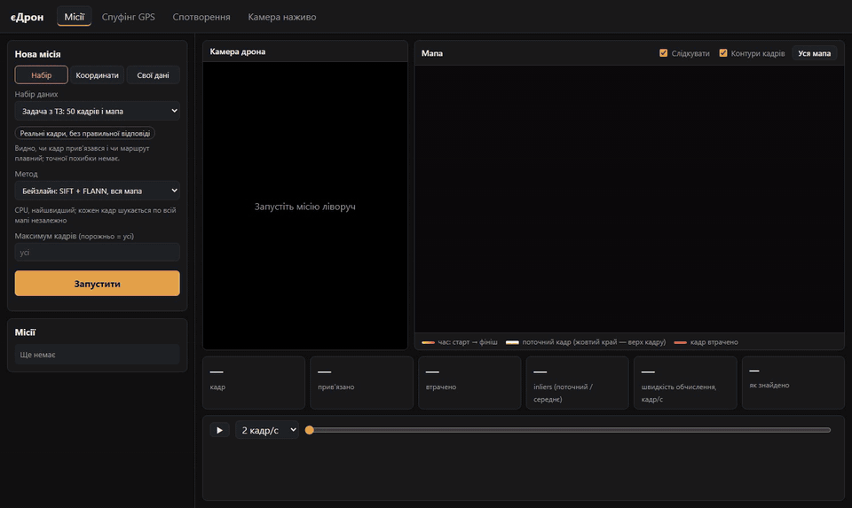
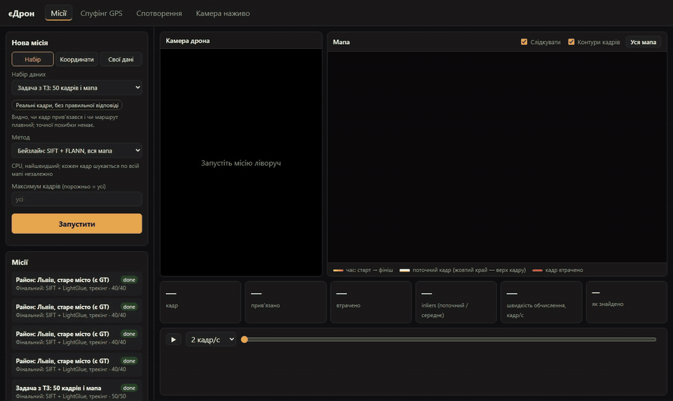
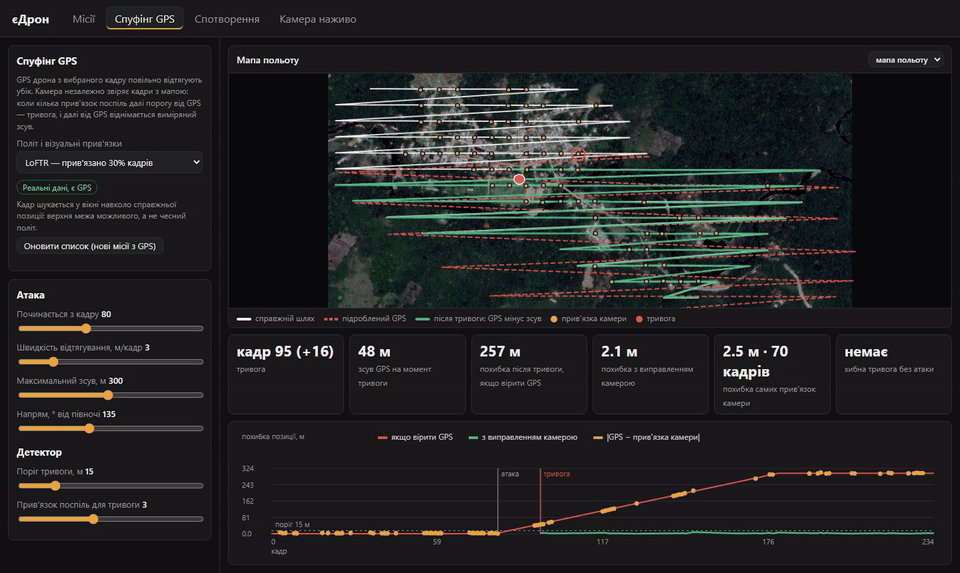
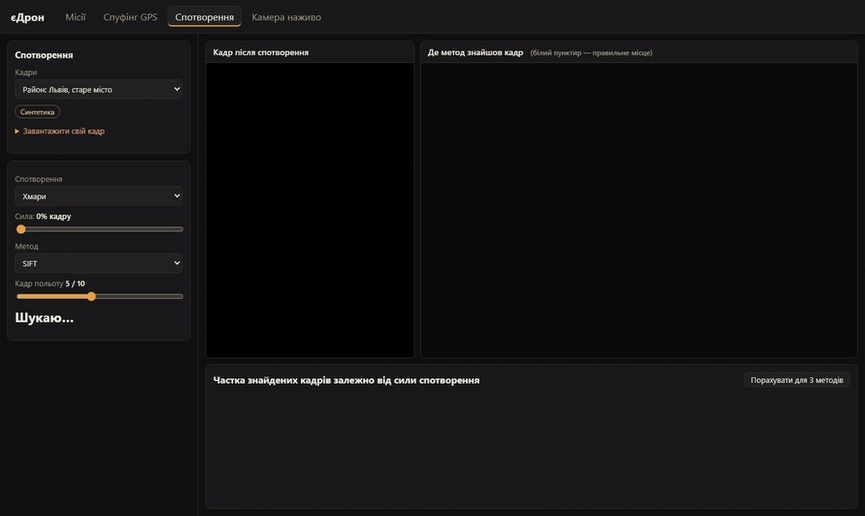
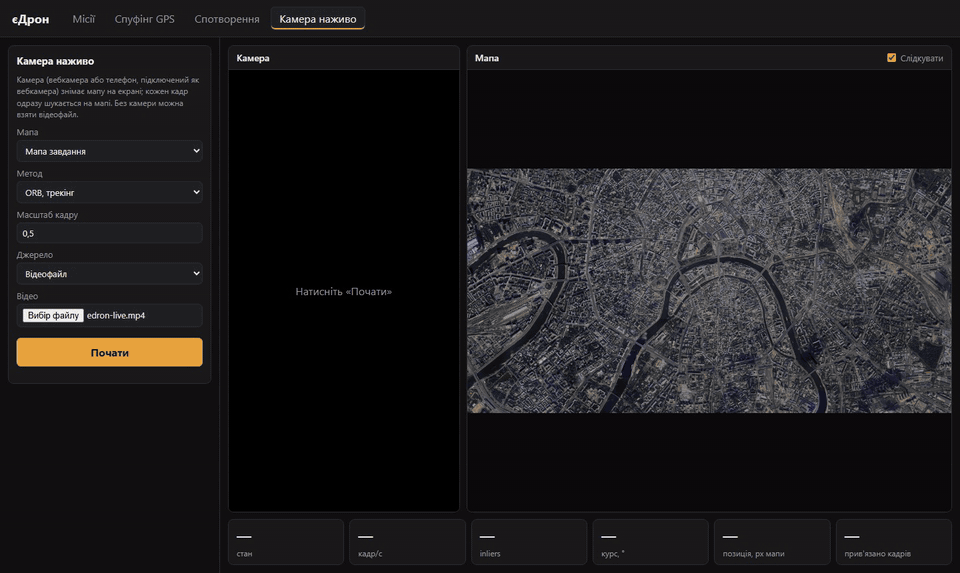

# VisualOdometrySpectronHackathon

Тестове завдання It-Jim «Classic CV: Drone navigation» 2026, рівень Advanced: кадри з дрона зіставляються із
супутниковою мапою, і на мапі відновлюється маршрут польоту. Фінальний метод — SIFT + LightGlue з трекінгом у вікні
мапи (`configs/map/final.yaml`). План робіт і чекліст — [docs/ROADMAP.md](docs/ROADMAP.md), презентація —
[docs/presentation/](docs/presentation/).

## Демо-застосунок єДрон

Вебзастосунок показує роботу методу наживо. Дрон «летить» по мапі кадр за кадром: ліворуч — кадр камери, праворуч —
мапа з маршрутом, що наростає. Окремі вкладки показують виявлення підробки GPS, стійкість до спотворень і локалізацію
з камери в реальному часі. Конвеєр той самий, що в експериментах (`vo.localize.run_localization`), застосунок лише
отримує кожен кадр через колбек. Технічні подробиці — в [app/README.md](app/README.md).

### Запуск

```powershell
& python -m pip install -r requirements.txt -r requirements-app.txt   # + requirements-learned.txt для навчених методів
& python scripts/download_data.py                        # 50 кадрів і мапа завдання
& python -m app                                          # http://127.0.0.1:8080
```

- **Доступ із телефона чи іншого ПК у локальній мережі:** `& $py -m app --host 0.0.0.0`, далі відкрити
  `http://<IP цього ПК>:8080`. Камеру браузер дає лише на `127.0.0.1` або через HTTPS.
- **Набори даних** з'являються в списку автоматично, якщо вони є локально: синтетика, власні відео, райони з
  `scripts/make_area.py`, реальний політ UAV-VisLoc #24 (див. `configs/datasets.yaml`).
- **Методи, для яких бракує пакетів** (torch, lightglue, kornia), показані неактивними. Класичний конвеєр працює
  без GPU.

### 1. Місії: маршрут дрона на мапі



*50 кадрів завдання, фінальний метод SIFT + LightGlue на GTX 1650. Усі 50 кадрів прив'язано до мапи, ~4.8 кадр/с.
GIF прискорено втричі.*

**Як запустити місію:** зліва обрати набір і метод, натиснути **«Запустити»**. Кадри рахуються у фоні й
показуються у вибраному темпі (0.5–15 кадр/с).

**Що на екрані:**
- **Камера дрона** — поточний кадр.
- **Мапа:**
  - маршрут, колір якого показує час (від жовтого на старті до червоного на фініші);
  - контури всіх кадрів;
  - поточний кадр: жовтий край — верх кадру, стрілка — курс;
  - позначки START / FINISH;
  - для наборів із правильною відповіддю — справжній маршрут пунктиром.

  Режими «Слідкувати» й «Уся мапа»; масштаб — коліщатком миші, зсув — перетягуванням.
- **Статистика:**
  - номер кадру, скільки кадрів прив'язано і скільки втрачено;
  - inliers (поточні й середні) і швидкість;
  - як знайдено кадр: трекінг у вікні або пошук по всій мапі;
  - для наборів із GT — похибка в пікселях мапи.
- **Таймлайн:**
  - повтор зі зміною швидкості;
  - стовпчиковий графік inliers, клік по стовпчику переходить до кадру.

**Після завершення:**
- **Результати:** `route.png`, `route_zoom.png`, `trajectory.csv`, `metrics.json`.
- **Посилання на конкретний момент:** `http://127.0.0.1:8080/#job=<id>&k=<кадр>&view=fit`.

### 2. Місії з геоприв'язкою: маршрут у GPS



*Синтетичний політ над старим Львовом (40 кадрів, мапа з тайлів Esri). Медіанна похибка — 0.43 px мапи (0.34 м).
Наприкінці відкривається інтерактивна мапа `route_map.html`. Прискорено вдвічі.*

**Звідки береться мапа з координатами:**
- **Вкладка «Координати».** Вказати широту, довготу й розмір ділянки. Мапа завантажується з супутникових тайлів
  Esri, над нею генерується політ із точною відповіддю.
- **Вкладка «Свої дані».** Фото кадрів або одне відео, необов'язково CSV з GPS (назва кадру, lat, lon). З GPS і
  без своєї мапи мапа будується з тайлів навколо треку, і похибка рахується в метрах відносно GPS.

**Що додається для таких мап:**
- підкладка «вулиці» / «супутник Esri»;
- інтерактивна мапа з шарами маршруту, кадрів, контурів і GT;
- `route.geojson` і `trajectory_gps.csv` (широта й довгота кожного кадру).

> Похибка на синтетиці оптимістична: кадри вирізані з того самого знімка, що й мапа. Застосунок позначає кожен набір
> як «Синтетика», «Реальні дані, є GPS» або «Реальні кадри, без правильної відповіді».

### 3. Спуфінг GPS: камера помічає підробку



*Реальний політ UAV-VisLoc #24. Змінюються швидкість і напрям атаки та поріг детектора, наприкінці — прив'язки з
островів + DINOv2, перевірені XFeat. Прискорено в 1.5 раза.*

**Як працює детектор:**
- З вибраного кадру GPS повільно відтягують убік (до максимального зсуву).
- Камера незалежно від GPS звіряє кадри з мапою.
- Тривога вмикається, коли кілька візуальних прив'язок поспіль далі порогу від GPS (за замовчуванням 3 поспіль,
  15 м).
- Після тривоги позиція = GPS мінус виміряний камерою зсув.

**Що на екрані:**
- **Мапа:**
  - справжній шлях;
  - підроблений GPS;
  - виправлений шлях;
  - точки прив'язок і момент тривоги.
- **Числа:**
  - коли спрацювала тривога;
  - на скільки встиг зсунутися GPS;
  - похибка з GPS і з виправленням камерою;
  - чи є хибна тривога без атаки.
- **Графік похибки** по кадрах.

**Налаштування:** повзунки атаки (початок, швидкість, максимум, напрям) і детектора (поріг, кількість прив'язок).
Усе перераховується миттєво.

**Джерела прив'язок:**
- прив'язки методів на польоті #24, у трьох режимах:
  - вікно навколо відомої позиції (верхня межа);
  - острови + DINOv2 з масштабом із цього польоту;
  - острови + DINOv2 без підказки — чесний режим;
- будь-яка завершена місія з GPS.

> Обмеження: у реальному польоті вікно пошуку мало б давати інерціальна навігація, а не GPS. Її дрейф не змодельовано.

### 4. Спотворення: де метод ламається



*Кадр із польоту над Львовом під дедалі сильнішими хмарами, темрявою й розмиттям. Праворуч — де SIFT знайшов кадр
(білий пунктир — правильне місце). Прискорено в 1.5 раза.*

**Як користуватися:**
- Обрати спотворення (6 видів), силу, метод (SIFT / ORB / AKAZE) і кадр польоту.
- Знизу — частка знайдених кадрів залежно від сили спотворення. Для Львова одразу показано збережений прогін на
  30 кадрах, кнопка «Перерахувати» рахує криві наново.
- У «Завантажити свій кадр» можна перевірити власне фото. Правильною відповіддю вважається місце, де метод знаходить
  кадр без спотворень.

### 5. Камера наживо



*Власне відео IMG_0061: телефон знімає мапу завдання з монітора. Метод ORB з трекінгом, ~4 кадр/с, 40 з 40 кадрів
прив'язано. Прискорено в 1.5 раза.*

**Звідки кадри:**
- вебкамера;
- телефон, підключений як вебкамера;
- відеофайл.

**Як це працює:** браузер шле кожен кадр на сервер, той шукає його на мапі класичним трекінгом (SIFT / AKAZE / ORB),
а мапа одразу показує позицію, курс і слід.

**Швидкість на мапі завдання (3645×1845) і CPU:**
- ORB — найшвидший, ~4 кадр/с;
- SIFT і AKAZE — ~1–1.5 кадр/с;
- перший кадр шукається по всій мапі, ~2.5 с.
